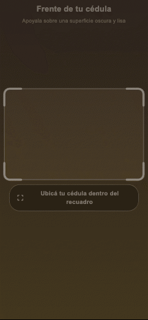
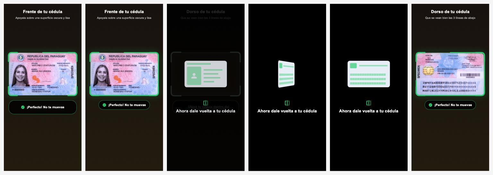
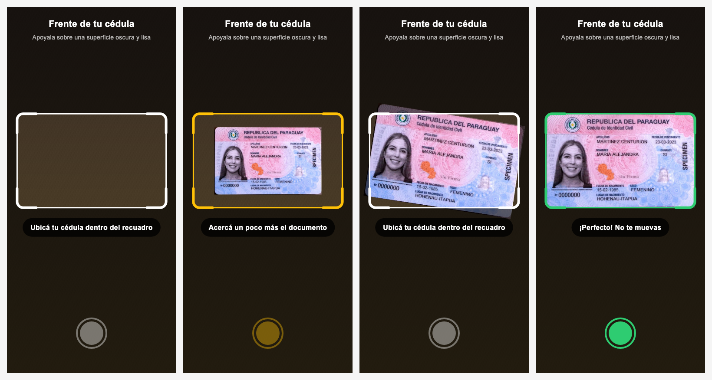
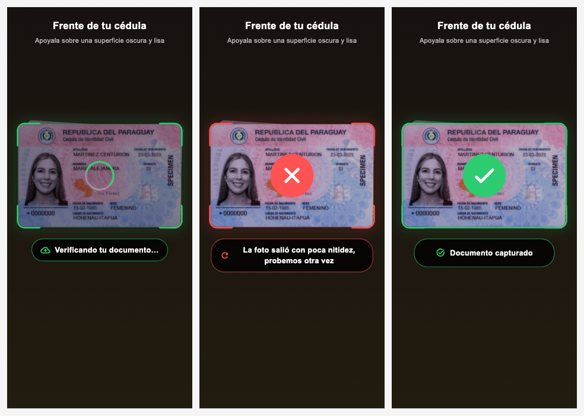
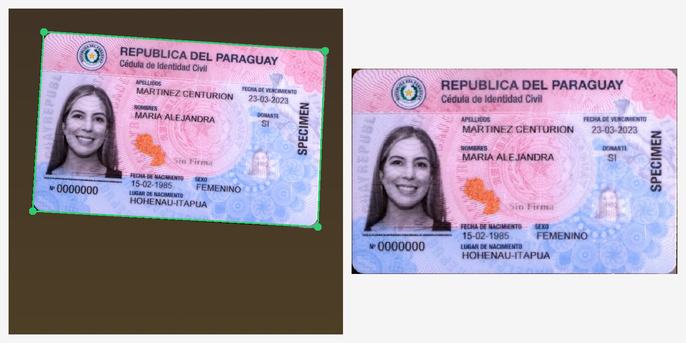

# id_document_scanner

Escáner de cédula paraguaya para Flutter. Abre la cámara, guía al usuario con un recuadro animado y saca la foto sola cuando el documento está alineado, enfocado y bien iluminado. Después **recorta solo la cédula**, enderezada, **verifica que sea una cédula paraguaya** (leyendo la MRZ del dorso con un OCR propio) y espera a que tu app (por ejemplo, tu backend) la apruebe antes de pasar al dorso.

La detección, el recorte y el OCR están hechos en **Dart puro** y corren en el dispositivo. No usa ML Kit, ni Firebase, ni servicios en la nube. Las únicas dependencias son `camera` (el plugin oficial de Flutter) e `image` (también Dart puro).

## Vista previa

Flujo completo: buscar, listo, captura, dar vuelta y dorso.



Momentos clave de la animación:



Mensajes según lo que ve la cámara (sin documento, lejos, torcido, listo):



Validación con el backend (verificando, rechazado, aceptado):



Recorte: a la izquierda, los bordes detectados en la foto; a la derecha, lo que recibe tu backend.



> Las imágenes se generaron con los widgets reales del SDK y los especímenes públicos de la cédula paraguaya. La cámara está simulada.

## Qué hace, paso a paso

```
por cada lado (frente → dorso):
  detectar en vivo ─► foto ─► recortar solo la cédula ─► ¿es cédula paraguaya? ─► validator(capture)
                                                               │                       │
                         no: "Esto no parece una cédula paraguaya", repite el lado     │
                                                       rechazado: muestra el motivo y repite el lado
                                                       aceptado: check ─► siguiente lado (o onCompleted)
```

1. **Detección en vivo:** el recuadro se pone verde cuando los bordes de la cédula coinciden con él y la imagen está nítida y sin reflejos.
2. **Foto:** se toma sola cuando la cédula queda quieta unos instantes. También puede ser manual, con `showCaptureButton`.
3. **Recorte exacto:** en la foto a resolución completa vuelve a buscar los 4 bordes, ajusta una recta por cada lado, calcula las esquinas y **corrige la perspectiva** a la proporción ID-1 (85,6 × 54 mm). El resultado es un JPEG con solo la cédula.
   - Si no encuentra los bordes con precisión, rechaza la foto y pide otra (`requirePreciseCrop`). Así a tu backend nunca le llega una imagen con fondo.
4. **Detección de fotos de pantallas y fotocopias** (`rejectReproductions`, activada por defecto). Ver [Seguridad](#seguridad-foto-de-la-cédula-física).
5. **Verificación de cédula paraguaya** (`verifyDocument`, activada por defecto). Si no pasa, el SDK la rechaza sin llamar a tu `validator`:
   - **Dorso:** lee la MRZ con el OCR propio y exige que cierren los 4 dígitos verificadores ICAO, que el país emisor sea `PRY` y que el código sea de cédula (`IN` en la nueva, `ID` en la anterior). Con eso también **detecta qué modelo es** y entrega los datos: número, apellidos, nombres, nacimiento, sexo y vencimiento.
   - **Frente:** compara el encabezado fijo ("REPUBLICA DEL PARAGUAY / Cédula de Identidad Civil" y el escudo) con referencias de **los dos modelos**, y detecta solo cuál es, aunque se haya elegido el otro.
6. **Validación:** llama a tu `validator` con la captura. Mientras esperás la respuesta, el SDK muestra la foto congelada dentro del recuadro y un indicador de carga.
7. **Resultado:**
   - **Aceptada:** muestra un check y pasa solo al siguiente lado, con la animación de dar vuelta. Con `autoAdvance: false`, decidís vos cuándo continuar.
   - **Rechazada:** el recuadro tiembla en rojo, muestra tu mensaje y vuelve a escanear el mismo lado.
8. **Fin:** cuando todos los lados fueron aceptados, llama a `onCompleted` con un `ScanResult`.

## Uso

```dart
final controller = IdDocumentScannerController(
  documentType: .paraguayIdCurrent,                    // o .paraguayIdLegacy
  sides: const [DocumentSide.front, DocumentSide.back], // orden del flujo
  validator: (capture) async {
    // Tu lógica: subir el recorte, llamar a tu caso de uso, etc.
    final response = await uploadDocumentUseCase(side: capture.side, image: capture.cardImage);
    return response.ok
        ? CaptureValidation.accepted(data: response.id)
        : CaptureValidation.rejected(message: response.reason);
  },
);

IdDocumentScanner(
  controller: controller,
  title: controller.side == .front ? 'Frente de tu cédula' : 'Dorso de tu cédula',
  messages: ScannerMessages(searching: context.l10n.scanSearching, validating: context.l10n.scanValidating),
  style: ScannerOverlayStyle(readyColor: context.palette.successColor!, errorColor: context.palette.errorColor!),
  onCompleted: (result) {
    result.front!.cardImage;                  // recorte aceptado del frente
    result.validationData[DocumentSide.back]; // lo que devolvió tu validator para el dorso
    // Navegar al siguiente paso de tu flujo.
  },
);
```

Recuerda llamar a `controller.dispose()` cuando cierres la página.

### Controlar el flujo

| Necesito… | Cómo |
|---|---|
| Validar con mi backend antes de seguir | `validator`: devuelve `CaptureValidation.accepted()` o `.rejected(message: …)` |
| Que un error de red cuente como rechazo | Ya funciona así: una excepción dentro de `validator` se trata como `rejected` |
| Decidir yo cuándo pasar al dorso | `autoAdvance: false` y llamar a `controller.nextSide()` (por ejemplo, desde `bottomBuilder` cuando `status == .captured`) |
| Repetir un lado ya aceptado | `controller.retakeSide(.front)` |
| Empezar de cero | `controller.reset()` |
| Escanear solo un lado | `sides: const [DocumentSide.front]` |
| Ver cada foto antes de validarla | `onCaptured` |
| Guardar lo que respondió el backend | `CaptureValidation.accepted(data: …)`, que después llega en `ScanResult.validationData` |

`DocumentCapture` incluye:
- `cardImage`: JPEG con solo la cédula. Es lo que hay que subir.
- `isPreciseCrop` y `corners`: si el recorte fue exacto y dónde estaban las esquinas en la foto original.
- `photoPath`: la foto completa original.
- `side` y `documentType`.
- `cropFields()`: recortes de cada campo según la plantilla, para un paso de OCR posterior.

### Verificación y datos de la MRZ

Desde tu `validator` (o en `onCompleted`) ya tenés el resultado de la verificación:

```dart
validator: (capture) async {
  final verification = capture.verification!;      // ya pasó: es una cédula paraguaya
  final mrz = verification.mrz;                    // solo en el dorso
  mrz?.documentNumber; mrz?.surnames; mrz?.givenNames; mrz?.birthDate; mrz?.expiryDate;
  verification.detectedType;                       // .paraguayIdCurrent / .paraguayIdLegacy
  ...
}
```

También se puede usar sin la cámara:

```dart
final verification = await const ParaguayIdVerifier().verify(jpegDeLaCedula, .back, .paraguayIdCurrent);
final reading = const MrzReader().read(grayImage, zonaMrz); // OCR de la MRZ
MrzParser.parse(lineas);                                    // validar texto ya leído
```

**Cómo funciona el OCR de la MRZ:** la MRZ está impresa en OCR-B, una fuente de ancho fijo con 37 símbolos posibles (`0-9 A-Z <`), en 3 líneas de 30 caracteres. El lector encuentra las 3 líneas, divide cada una en 30 celdas según el paso medido y compara cada carácter con plantillas OCR-B. Después corrige con los dígitos verificadores, campo por campo, y solo en las posiciones dudosas: si probara todas las sustituciones posibles, alguna terminaría cerrando un dígito verificador (módulo 10) por casualidad.

**Medido con escenas simuladas a partir de los especímenes:**
- **Dorso:** se verificó en 44 de 45 combinaciones de rotación (±4°), brillo (0,6 a 1,2), desenfoque y JPEG al 75%. La única falla fue la combinación más difícil, y en ese caso pide otra foto.
- **Frente:** se verificó en las 45 combinaciones.
- **Rechazos:** 0 aceptaciones falsas en 48 intentos con una tarjeta de otro país, ruido, la cédula invertida y frente y dorso intercambiados. En el frente, lo que no era cédula sacó como máximo 0,26 de puntaje, contra un umbral de 0,5.

### Personalización

| Parámetro | Para qué sirve |
|---|---|
| `title` / `subtitle` | Texto fijo arriba del recuadro |
| `messages` | Texto de cada estado, incluidos `validating`, `rejected`, `cropFailed`, `reproductionDetected`, `notParaguayanId`, `mrzUnreadable`, `flipToBack` y `completed` |
| `style` | Colores (velo, normal, aviso, verde de "listo" y rojo de error), bordes, esquinas y tipografías |
| `style.showScanLine` / `style.enableHaptics` | Línea de escaneo animada y vibración |
| `overlayBuilder` | Reemplaza todo el overlay por uno propio. Recibe el estado, el mensaje, el rect del recuadro, el color y el progreso |
| `bottomBuilder` | Contenido adicional abajo (ayuda, cancelar, "Continuar") |
| `showCaptureButton` | Botón de disparo manual, que solo se habilita en verde |
| `showDebugInfo` | Muestra en pantalla los valores de detección, para calibrar |
| `DetectionConfig` / `CardEdgeRefiner` | Umbrales de detección en vivo y del recorte exacto |
| `rejectReproductions` / `reproductionDetector` | Rechaza fotos de pantallas y fotocopias, o ajusta sus umbrales |
| `verifyDocument` / `verifier` | Activa o desactiva la verificación de cédula paraguaya, o ajusta su umbral (`minHeaderScore`) |

## Animaciones

- **Entrada:** el recuadro se acomoda en su lugar y el título baja con un fundido.
- **Buscando:** las esquinas "respiran" y una línea de escaneo recorre el recuadro.
- **Listo:** el recuadro se pone verde con un brillo, y el borde se va trazando mientras la cédula está quieta (es el progreso de la captura automática).
- **Captura:** flash de cámara, vibración y la foto recortada congelada dentro del recuadro.
- **Validando:** indicador de carga sobre la foto.
- **Aceptado:** un check animado con rebote. **Rechazado:** una cruz roja, vibración y el recuadro tiembla.
- **Cambio de lado:** animación 3D de la tarjeta dándose vuelta.
- **Mensajes:** cada cambio entra con fundido y deslizamiento, con un ícono según el estado, y la píldora cambia de tamaño suavemente.

## Cómo detecta y recorta

**En vivo (cada 120 ms):** toma solo el plano de luminancia (Y), lo remuestrea en una grilla chica del área del recuadro y busca en cada lado un borde recto y continuo. El texto y los fondos de seguridad no forman líneas continuas, así que no se confunden con el borde. Con 3 de los 4 lados alineados, la cédula se considera encuadrada. Además mide la inclinación de cada borde, el brillo, el reflejo y la nitidez.

**En la foto:** convierte la posición del recuadro en la vista previa a coordenadas de la foto, teniendo en cuenta que pueden tener proporciones distintas. Después toma 56 muestras del borde en cada lado, ajusta una recta descartando los puntos atípicos, intersecta las 4 rectas para obtener las esquinas y endereza la cédula con `copyRectify`. Con la cédula girada hasta 4°, las esquinas quedan a menos de 4 px de las reales en una tarjeta de 900 px.

## Seguridad: foto de la cédula física

El SDK rechaza, sin pedirle nada extra al usuario, las fotos de **una pantalla** (monitor, celular, tablet) y de **una impresión en color**, y muestra el mensaje `messages.reproductionDetected`.

**Cómo funciona:**
- **Pantallas:** una cámara apuntando a una pantalla registra la grilla de píxeles y sus subpíxeles rojo, verde y azul, lo que produce moiré.
- **Impresiones:** una impresión láser u offset lleva la trama de puntos de la impresora.
- **En los dos casos** son patrones estrictamente periódicos, que se ven como picos finos y aislados en el espectro de frecuencias altas (transformada de Fourier en Dart puro, sobre 16 parches de la cédula ya recortada). La señal más clara está en el color: los subpíxeles de la pantalla y la trama de colores de la impresión. La impresión de seguridad de la cédula real (guilloches) y el ruido del sensor reparten su energía y no forman esos picos.
- **El resultado** queda en `capture.reproduction`, con los puntajes de brillo y color y la decisión. Los umbrales se ajustan con `ReproductionDetector(chromaThreshold:, lumaThreshold:)`.

**Medido en 108 combinaciones simuladas** de rotación, luz, desenfoque y JPEG:
- **Cédulas reales:** ninguna rechazada. Su puntaje de color máximo fue 389.
- **Pantallas e impresiones:** todas rechazadas. La impresión con menor puntaje dio 1.932, contra un umbral de 1.500.

**Límites:**
- Las pantallas y las impresiones de la prueba son **simuladas**: falta calibrarlo con fotos reales de monitores, celulares y fotocopias.
- **No detecta** impresoras de inyección de tinta con trama estocástica (sin patrón periódico), réplicas físicas plastificadas ni falsificaciones.
- **Pendiente:** la prueba de inclinar la cédula para ver los hologramas, que agrega un paso al flujo. Se decidió no usar flash.

## Datos de referencia

`tool/generate_references_test.dart` genera los datos que el SDK lleva embebidos:
- `lib/src/ocr/ocrb_glyphs.g.dart`: las plantillas OCR-B, renderizadas desde `tool/fonts/ocrb10.otf`. Es una fuente de licencia libre; ver `tool/fonts/OCRB_LICENSE.txt`. Solo se usa en desarrollo y no viaja en la app.
- `lib/src/verification/paraguay_front_references.g.dart`: el encabezado del espécimen público.

Para regenerarlos:

```bash
fvm flutter test tool/generate_references_test.dart
```

## Plantillas

`ParaguayIdTemplates.currentFront`, `currentBack`, `legacyFront` y `legacyBack` indican dónde está cada `DocumentField` (incluidas las 3 líneas de la MRZ), en coordenadas normalizadas a la tarjeta. Las dos caras de la cédula nueva se verificaron sobre especímenes públicos. Las de la cédula anterior se estimaron y **hay que calibrarlas con capturas reales**.

## App de ejemplo

```bash
cd example && fvm flutter run
```

En la pantalla inicial podés elegir:
- El modelo de cédula: nueva o anterior.
- Captura automática o manual.
- Si pasa solo al dorso o si la app decide cuándo continuar.
- **Simular el rechazo del backend** en el primer intento de cada lado.
- Mostrar los valores de detección en pantalla.

El backend simulado está en `example/lib/services/fake_identity_backend.dart`. Ahí va tu llamada real.

## Publicar una versión

El workflow `.github/workflows/publish.yml` publica en pub.dev cada vez que se sube un tag `vX.Y.Z` sobre un commit de `main`. Antes de publicar verifica que el tag coincida con la `version` del `pubspec.yaml` y corre `flutter analyze`, los tests y `pub publish --dry-run`. Si algo falla, no publica.

1. Subí la `version` en `pubspec.yaml` y agregá la entrada en `CHANGELOG.md`.
2. Commiteá y subí a `main`.
3. Creá el tag y subilo:

```bash
git tag v0.2.0 && git push origin v0.2.0
```

## Limitaciones conocidas

- Solo funciona en orientación vertical, con la tarjeta horizontal. Para fijar la orientación, llama a `SystemChrome.setPreferredOrientations([.portraitUp])`.
- La cédula tiene las esquinas redondeadas y el recorte es rectangular, así que en las 4 esquinas queda un triángulo mínimo del fondo.
- Los umbrales se ajustaron con escenas sintéticas armadas a partir de los especímenes. Hay que calibrarlos en dispositivos reales con `showDebugInfo: true`.
- **Referencia del frente de la cédula anterior:** sale de una franja del encabezado de una foto de muestra, sin datos personales (`test/fixtures/paraguay_id_legacy_front_header.png`). Conviene reemplazarla por un espécimen oficial cuando se consiga.
- **Nombres (línea 3 de la MRZ):** no tienen dígito verificador, así que una letra mal leída no se puede detectar. El número de documento y las fechas sí están validados.
- **Lo que no detecta:** verifica que el documento *tenga la forma* de una cédula paraguaya y que su MRZ sea coherente. **No detecta falsificaciones** (una copia impresa de una cédula real pasaría) ni hace prueba de vida. Eso queda para tu backend o un servicio de KYC.
- **OCR:** solo lee la MRZ. Los textos del frente (nombres, fechas) no se leen; los mismos datos salen de la MRZ del dorso.
